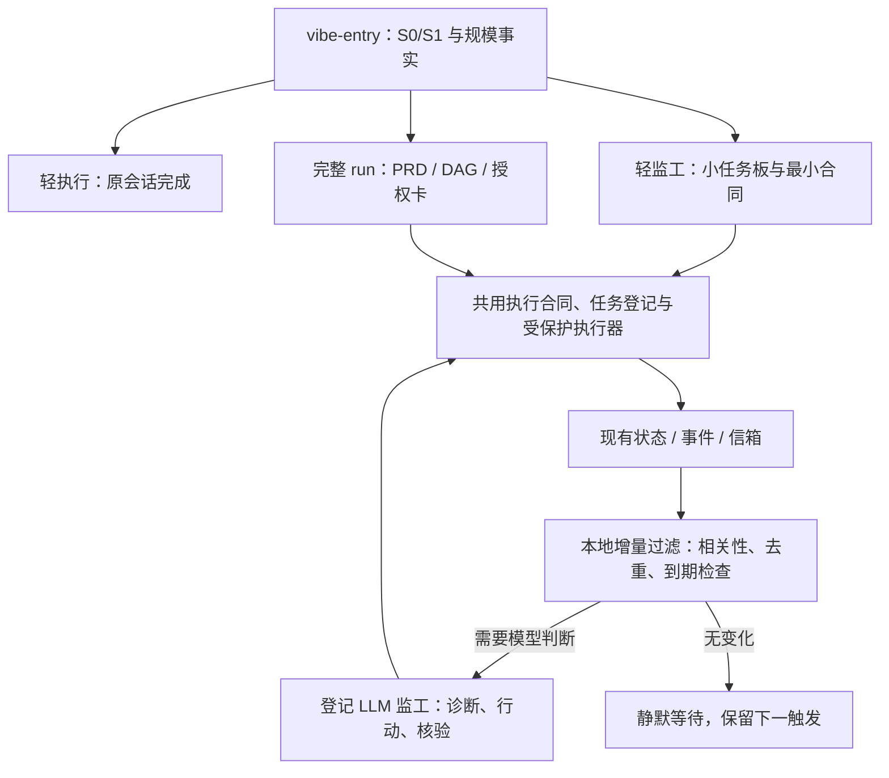

# VibeGuide V6.0 自适应监工与 Token 效率优化方案

日期：2026-11-09。状态：**设计提案，已同步本轮需求修订；不是实施授权、已发布能力或现有 run 的新授权。**

产品合同修订见 [V6.0 PRD r2](2026-11-09-adaptive-supervision-token-efficiency-prd.md)：包含 Ollama 混合分工、worker 轮询/返工治理、到限自动接力，以及用户最新确认的“首装/升级必须初始化 Ollama，已有则接入”。新增入口真实触发验收，基于历史案例重审路由与宿主上下文策略。已确认方向与待确认默认值分别标明，旧批准 PRD 和活跃 run 不被本设计改写。

## 0. 一句话方案

**入口按工作规模选择轻执行、轻监工或完整 run；执行期由 LLM 负责诊断与推进，VibeGuide 负责事实、受约束执行和恢复；本地机械层先过滤，再把角色相关的最小增量交给模型。**

`blocked_unknown` 保留“当前证据不足、相关动作不能安全继续”的事实含义，但只作为待处理信箱状态，不能自行终止监工责任。通知已发、信箱已读、超时、预算耗尽都不等于问题解决。

本提案接受用户提出的全部方向。评分、节点数、时长、文本预算是本文的**建议初始值**，不是用户已逐项批准的产品常量；实施前一并确认。

### 完成标准

1. 工程未知进入监工闭环：读证据、定位责任、采取行动、核验结果、继续 DAG，或留下有解除条件的合法等待。
2. 无变化、无到期动作时本地检查不调用模型；宿主不支持唤醒前过滤时，明确披露仍存在的模型唤醒开销。
3. 已授权执行与接班无需读取 `prd-guide` 协议，仍完整继承业务验收和授权限制。
4. 不再因可修复回执形状、重复传输、可唯一消解的工程不一致等问题无限失败或要求产品经理代排障。
5. 三档路由有确定规则、续接不反复评分、错误 cron 可在生效前发现；迁移不接管或破坏已有 run。
6. 在功能、审查独立性、可见性和安全不退化的前提下，按真实 usage 验证效率；不先许诺节省百分比。
7. 首装/升级进入 Ollama 安装或接入、模型准备与真实推理自检；入口分别验证规则采纳、宿主逐请求触发和受控动作覆盖，不能以文件存在/占位 complete 作为就绪。

### 本轮边界

只编写本设计。没有改源码、项目规则、自动化或活跃 run；不安装依赖、不创建 worker、不执行 Git 交付、不写统一知识库。后续实施必须另行形成 Spec/Issue、计划和适用授权。

## 1. 证据与问题优先级

### 1.1 基线分开使用

- VibeGuide 源码基线：v5.2.7，提交 `885236783e1a680d7165ee2ee2c4e0002430a30a`，本机目录 `.worktrees/replay-system-telemetry-513efb07`。主 checkout v5.1.16 不能冒充此版本。本文源码行号均指该固定基线。
- 既有需求：[5.2.8 监工责任 PRD](2026-11-04-v528-supervisor-responsibility-prd.md)。其中 F1–F6 已规定主动诊断、同平台恢复、业务验收和安全接续。本提案承接这些约束，新增入口与成本优化，不另建互相竞争的恢复方案。PRD 不代表实现。
- Akasha：上一轮审计记录的上游提交为 `dc63127bb5b464c662739de47e3475cf56096825`；本轮本机 vendor HEAD 已为 `d6d8c5bd2805b43717add834988e737c469938bc`，本地没有可解析的前一提交对象。当前技能可用于机制参考，不能据此重新宣称固定提交和当前全文完全一致。实施抽取前重新获取并核验选定来源。
- 历史 usage 是宿主报告口径，不是独立账单；历史 run 也不能证明加载的运行时与上述源码完全相同。

### 1.2 已核验的成本线索

| 线索 | 观察 | 设计含义 |
|---|---|---|
| 正确原线程心跳 | 两轮触发均约 380 字节，但首次请求输入分别为 122,508、125,085 tokens；包含各次工具往返的整轮输入约 49.5 万、50.5 万，其中大部分命中缓存 | 短心跳不等于小上下文；要同时减少唤醒次数、历史重放和同事实往返 |
| 缓存不稳定 | 同一会话另一轮首次输入 242,227，缓存为 0；原因未查明 | 不能把高缓存命中当成本保证 |
| 错误 cron 样本 | 9 个独立 automation 会话，累计 input 3,540,409、其中 cached 3,032,759、未缓存 507,650、output 26,603；当前配置已暂停 | 属于错误新会话调度，不是正确 heartbeat 的固定成本；优先防错 |
| worker 请求文本 | 166 份历史落盘 prompt 合计 1,029,794 字节；已答决策正文 255,000 字节，约 24.76% | 相关决策归一、按版本发差异有明确空间；落盘不等于已发送/已计费 |
| 协议体积 | `prd-guide` 43,913 字节，入口 10,017 字节，worker 协议 19,121 字节 | 拆角色、拆阶段，而非改成引用后又让每个角色全量读回 |
| 机械检查 | daemon 正常 20 秒 tick 不调用模型；已有 8,192 字节 CLI 输出上限、每班一次监工卡、120 秒重复检查、idle 退避和 24,576 字节 handoff 上限 | 保留并补齐，不重做第二套预算、去重和调度系统 |

上述轮次可能包含真实诊断工作，不能全部标成浪费。字节与 token 不互换；24.76% 是请求文本占比，不是总 token 或费用节省率。没有 Akasha 同题实跑，不输出双方净效率倍数。

### 1.3 主要代码落点

| 当前落点 | 当前行为/缺口 | 拟调整 |
|---|---|---|
| `daemon.py:651/720/799` | blocked 宽限期或升级后可以进入 parked，退出服务；待办仍在不代表有人处理 | 工程未知不按时间自动解除服务责任；等待/故障/完成分别表达 |
| `supervisor.py:3615/3657/3843` | 重复检查、卡片引用、聚合 beat 已存在，但发生在模型被唤醒之后 | 保留 beat，增加唤醒前判断；beat 提供闭环所需的紧凑增量 |
| `supervisor_wakeup.py:20` | idle 退避，work/unknown 保持基础频率 | 由未完成事项的下一动作/到期时间决定唤醒，不按 unknown 标签固定叫醒 |
| `worker_questions.py:271` | 每次派发拼接全部 run 级已答原问题与结论 | 规范结论、适用范围、版本水位；全局约束仍全局有效 |
| `runners/provider_action.py:637/1874` | 续接拼接较多合同、规则、决策、finding | 首次初始化与续接分开；幂等短续接、按需取证 |
| `daemon.py:1070`、`short_session.py:88` | 恢复包无整包 token 限制；默认新开 CLI 短会话 | 普通诊断交登记监工，不按停滞次数另起平行修复模型 |
| `planner.py:17/89/806/882`、`session_entry.py:268` | 评分与路由模型绑定 `simple/light_plan/complex` | 新版本执行档位与旧复杂度字段解耦，保留旧读取兼容 |
| `protocols/__init__.py`、`initializer.py:209` | 协议物化/旧版摘要识别和本地编辑保护已存在 | 新协议继续用同一机制，不覆盖用户修改 |

## 2. 方案选择与最小架构

| 方案 | 优点 | 主要不足 | 结论 |
|---|---|---|---|
| 只修提示词、cron 和 blocked 提示 | 变更少、见效快 | 不能解决长历史、续接膨胀和协议耦合 | 作为第一批止损，不是完整方案 |
| **复用现有内核，增加轻量执行档和上下文投影** | 保留授权/任务身份/证据，针对主要浪费；不引入第二状态源 | 需要协议与调用链一起收口 | **推荐** |
| 独立移植 Akasha 全套执行器或重写 VibeGuide | 可单独调整 | 两套 writer、恢复、授权、状态和依赖容易漂移，迁移成本高 | 不采用 |



只新增确有职责边界的薄层：**入口路由策略、角色上下文投影及宿主/本地模型适配**；监工责任字段和唤醒水位尽量扩展现有信箱/快照，不增加另一套故障数据库、调度服务、向量库或多级代理。轻监工不是第二个 DAG 引擎。Ollama 是用户明确要求纳入 V6.0 初始化的第三方运行组件；除此不顺带新增不必要依赖，安装和许可仍须按交付授权执行。

## 3. 从 vibe-entry 开始：三档执行

### 3.1 难度画像与编排收益分开判断（修订候选）

保留五维 `steps/domains/uncertainty/failure_cost/toolchain` 及旧 8/15 作为对照，不将总分直接等同于编排档位。新 PRD §2–§3 根据八组定向历史案例提出“难度/风险画像＋编排收益决策树”，具体方法待整稿确认和回放校准。上一稿的 5 节点/3 并行/4 小时组合降为候选基线，不再推荐作统一硬门。

最小规模事实包括：真正独立可验收的业务节点 N、扣除写冲突/依赖/授权容量后的有效并行 P、预期周期（本会话/需续接/跨天），以及跨节点验收、多波协调、在途动作恢复是否确有需求。N 不含 reviewer、机械步骤或自动追加的 integration-review；估计附依据，缺失保持未知，不要求假精确。

| 档位 | 建议进入条件 | 实际工作方式 | 不做什么 |
|---|---|---|---|
| A 轻执行 `direct` | 原会话可可靠完成，无持续委派/协调收益；旧≤8 常是提示而非新硬门 | 原会话执行；按任务风险验证；高分分析/设计不强拆 worker | 不建 plan/run/daemon，不为了分数强行拆节点 |
| B 轻监工 `lean` | 有真实委派/独立审查收益，但小任务板足以管理；常见 1–4 业务节点、短周期或单长串行 writer | 最小合同、任务板、可见 worker、静默等待、独立审查、有界返工/安全接力 | 不强制完整 PRD 编写流程、完整 DAG 审计、频繁换班和定时新会话 |
| C 完整 run `run` | 持久跨节点协调、验收/副作用对账的收益明确，小任务板不足；或用户明确要求完整流程 | PRD→Spec/Issue→DAG→授权→完整监工；多节点/高并行/长周期是强提示 | 不把 integration_after 当启动硬依赖；不要求所有节点同时完成才验收 |

P 是计划某一波的真实可启动能力，不仅是首波 ready 数；计划值不冒充实际并发，不能把五个串行节点算成高并行。时间应区分有效工作和外部等待。少节点但合同/恢复复杂可选 C；大量短同构任务也可用 B 的有界批次，不单凭数量决定。

边界处理：

- S1=12、单节点、半小时：A，简短步骤后执行，跳过无收益的监工。
- S1=14、3 个独立节点、2 小时：B，可并行，不因“轻”强制串行。
- S1=18、2 节点、3 小时：B，高分不自动支付完整 run 成本。
- S1=19、8 节点、峰值 4 并行、跨天：C。
- S1=20、1 个长串行节点：B 持久续接，不为凑 C 拆假节点；确有完整审计需求时允许用户明确选 C。
- 四业务节点但涉及同 run 合同修订、跨节点验收及在途动作恢复：可以证据支持选 C，不因未到五节点被拒。
- S1=8 但 10 个节点、跨天：先检查评分是否低估步骤/工具链，不直接相信矛盾数据；不能靠低分漏掉编排成本。
- 不确定 P/H：先在原会话做最小拆分、查事实；未确定的只是编排收益，不是让用户填技术表格的新门。业务方向不明才问用户。

高失败代价意味着保留对应安全/验收约束，**不等于必须增加编排层级**。GUI 设计稿、真实授权、独立审查等与档位正交，三档都不能豁免。

评估比较旧路由、上一稿阈值组合、新决策树；历史按根任务分组，入口不使用未来故障信息，允许多档都合理；衡量无谓升级、遗漏恢复、总 token/耗时、人工介入及安全，不只看准确率。没有足够概率标注不宣称 ECE 已达标。完整样本与评估规则见新 PRD §2–§3。

### 3.2 入口按生命周期分流，不每拍重新规划

入口先识别“已有执行合同+有效 run/任务绑定”的继续、心跳、返工、接班。命中后执行最小身份/授权/状态预检，直达执行协议；不重复 S1、不回 PRD 规划。新需求、范围或验收变化才重新路由。仅出现“继续”一词但没有可靠绑定，不能猜 run。

入口正文目标≤4KiB：保留路由和必要边界，详细评分锚点/规划示例按需加载；不能把本来宿主强制注入的项目安全规则视为可自行跳过。

### 3.3 兼容与动态升级

- 路由输出增加版本化的 `execution_tier=direct|lean|run`、理由和规模事实。旧 `route/complexity_band` 保留原义；新字段不能偷偷挂在旧 `light_plan` 上让旧执行器误以为“不触碰 vibe”。
- 旧客户端只消费旧版本路由；请求新档位时需明确支持该协议版本。旧已持久化路由继续可读，不回写重评分。
- 仅给五个分数不再暗含“用户要求完整流程”；新增明确的完整流程意图/参数。旧 CLI 的显式分数升级语义在兼容入口保留并披露，不能无提示改掉。

### 3.4 入口实际触发与安装接线

固定 v5.2.7 基线现有链路为 `init` 物化技能/生成规则提案（`initializer.py:295/388`）→ agent 按 `scanner.py:604` 的规则自评 → 复杂时调用 CLI。`session_entry.py:268/293` 只有被调用才路由；`cli.py:2776–2783` 的 session screening 针对已发生的 CLI 调用，不能覆盖不调用 CLI 的请求/编辑。Claude 规则导入静态检查（`scanner.py:560`、`doctor.py:170`）也不能单独证明真实每轮触发。9 月入口合同明确不做平台 hook，10 月整合 PRD 的分诊钩子要求不能据此当成实现。

V6.0 采用一份内核、宿主薄适配、原执行边界：安装/升级时探测公开逐请求 hook/受控启动能力并经授权接线，真实测试新会话、后续新目标、恢复与委派。只有规则引导或覆盖部分工具时如实标明，不猜平台不支持，也不宣传拦截任意写入。只 session-start 不满足逐请求覆盖。

每轮仅注入短入口或角色绑定；S0 及有授权的心跳/返工/接班走快路径，不另建分诊模型、不读 PRD 协议、不必调用 CLI/Ollama。复用能力证据与事件记录协议/请求版本和路由，不存原话/历史、不以入口回执冒充授权。受控动作缺入口记录先修复/补评，真实授权/写权缺口才停相关副作用，不把可选 hook 元数据变成全局门。详细判据见 PRD §3.4、B21–B24；入口覆盖率与路由质量分别验收，真实首轮/后续输入计成本。
- B→C：保留成果、任务身份和证据，补齐确有需要的业务合同/DAG/授权；涉及拓扑或任务可见性变更时按现有规则使旧授权失效并确认后续范围。
- 运行中不因单次超过预计时长自动换档/重建任务；发现规模明显失真后先重估。C 不自动降为 B，不迁移活跃 run。

## 4. 将 Akasha 监工抽为 VibeGuide 原生轻监工

### 4.1 抽取的内容

1. 监工只下发目标、合同、边界和验收；developer 自主完成实现计划、开发与自测，监工不成为第二 writer。
2. 小任务板记录节点、依赖、任务 ID、平台/可见性、worktree/branch、状态/交付路径、cursor、最近消费版本。
3. 每个节点独立 cursor 和等待；先完成先审查、先释放名额、重算 ready，不等待整批 barrier。
4. 状态未变静默等待；有交付、真实阻塞、到期动作、异常才进入模型。普通监控进程不是开发 worker，不把“本地后台文件检测”误称为 worker 可见性降级。
5. 最大轮次内返工回原 developer，到限按 §8.4 安全自动接力；审查回原 reviewer，或由未参与实现的监工独立审查并保留其身份与证据。
6. 问题解决后恢复状态级监控，不持续拉日志和全量 diff。

### 4.2 不照搬的内容

- 不照搬固定模型、默认推送/合并、无限并发、平台 API 假设或 GitHub 定时流水线。模型跟随用户配置，Git 动作按明确授权，活跃并发仍受资源与授权约束。
- 不向只支持较短等待的工具传 20 分钟非法参数。本地监控可有较长有界生命周期；宿主等待调用使用已验证上限。等待调用频繁返回时真实统计其模型开销，不能宣传零 token。
- 不把独立 Review 缩成 developer 自审。轻监工默认“可见 developer+只读监工验收”；若当前项目规则要求两个独立可见任务，则在该模式获批前继续遵守。visible-sdd 的独立子代理、dual-visible 的独立可见 reviewer 也不能擅自互换。

轻监工可使用更小的节点合同和一次性范围确认，不强制先写完整 PRD；但本项目涉及监工/并行仍需展示适用授权卡。建议定义**同一授权模型的紧凑展示**，列目标/验收、节点/写范围、拓扑/可见性、并发和外部动作权限，不另创弱化授权体系。目标不清或有产品取舍时先澄清，不能以“轻”跳过。

### 4.3 整合和来源

建议随包新增 `lean-supervisor` 协议，按需物化；复用任务登记、信箱、状态原子写、受保护派发和独立验收接口，worker 不必安装完整 Akasha。

用户已明确提出抽取整合方向，但现有 AGENTS §7 默认禁止复制外部 Skill 源码。实施文件清单必须明确这是“经批准的原生化整合范围”，修订对应规则后才做，不把外部 Skill 整包复制为内部文件。优先对机制做最小原生适配；如复用文本/脚本，固定提交、记录来源、差异、版权和许可证。

当前 vendor 的 LICENSE 是 Apache 2.0 加商业支付附加条件，**不能仅标 Apache-2.0**；它也不能证明审计固定提交的许可证。选定来源的许可与分发要求须重新核验，不在本设计中作法律合规结论。

## 5. blocked_unknown：待处理信箱，而非监工终点

### 5.1 两个维度分开

- **节点执行状态**：可保留 `blocked_unknown`，表示当前相关动作证据不足。
- **问题处理进度**：复用信箱表达 `open → claimed → waiting / resolved`。`waiting` 仍是未解决事项；出现新证据或到期后重新可服务。无需为每种故障造一个枚举。

读取/通知回执只记录送达，不清除事项。只有原缺口被证据消除并通过必要复核，才能 resolved；resolved 也不自动等于节点 accepted。保留节点状态是兼容事实层，外部界面不再把它呈现成“监工只能停下”。

最小责任信息附在现有问题/恢复记录中：稳定事项 ID、关联节点/角色/代次、当前责任方/owner epoch、证据引用、下一动作或等待对象、下次检查时间/解除条件、动作与复核结果。不要把所有字段变成首次上报的冗长必填门；系统补身份，监工边诊断边补下一步。已有记录不重复拷贝。

### 5.2 监工收到信号后的闭环

1. **读**：取失败步骤、预期/实际、相关合同、最近尝试和精确证据，不先读完整会话。
2. **判**：区分信息缺口、上游输入缺失、代码缺陷、适配/运输故障、真实授权边界；不要求错误先匹配固定关键词才能处理。
3. **修**：查正确用法、消费未接收回执、协调上游、给原 worker 定向建议、安排原范围修复；监工不直接改业务代码。
4. **验**：核验原失败是否消失、必需材料是否补齐、独立 Review 是否通过。消息已发/日志增长/模型升级/HTTP200 都不是有效修复。
5. **推**：恢复节点、释放已验收容量、重算 ready；无法继续时留下具体合法等待，不无限空转。

同一根因阻塞多个节点，合并诊断事项并关联全部受影响节点，避免每个下游重复开修复。信息不全时继续安全取证；只有不能唯一判断且会改变产品/验收、授权或外部承诺时询问用户。

### 5.3 服务责任不会因宽限期结束而消失

- 删除“工程 unknown 等待若干分钟→视为已移交→无人继续”的语义。原 daemon `_parked/_closeout_status` 只可在真正完成、用户明确暂停/取消、或已验证的合法服务交接下退出相关服务。
- 全部节点暂时等待不必高频调用模型；保留本地轻量检测、持久责任、下一触发和可验证的唤醒路径。需释放服务进程时先证明另一个受支持机制已经接管，否则保持未解决服务故障，不能报健康 idle。
- 真正等用户决定：去重呈现一次，问题保持开放，答案到达后继续；仅受影响后缀暂停，无关 ready 节点可继续。
- 外部平台暂不可达：按具体故障到期重查，不假判不可用或成功。监工本身不可达则可靠告警/显示未移交，不能伪造有人负责。
- 安全边界证据不明：阻断可能不安全的动作，同时允许只读取证；影响面未确定时先保守保护可能受影响集合，不能擅自缩小范围。

### 5.4 防止“主动修复”变成高成本循环

以“事项+证据版本+动作参数+owner/任务代次”识别重复。相同证据、相同动作不得无限重新调模型/派发；连续无进展时更新因果诊断、找上游或合法等待，不自动换 reviewer 求通过。定时探测允许重试，但只在到期后进行，并区分探测和真正恢复动作。

沿用已有唯一认领、租约、幂等键；重放可重复送达但不能重复副作用。超时先对账，不因“没收到”再 create 一个任务。换班继承在途动作。普通不可达 successor 的至少三次真实恢复失败等边界不取消；轮询不计恢复次数，三次失败也不等于旧 writer 已终止。新增“返工耗尽接力”按 §8.4 独立触发，不伪记恢复失败，仍保留终止/退役与唯一 writer 校验。

## 6. 规划协议与执行协议彻底分层

### 6.1 协议读写矩阵

| 材料 | 授权前规划者 | 授权后监工/接班 | developer/reviewer |
|---|---|---|---|
| `vibe-entry` | 最小入口 | 只走绑定执行分支 | 最小角色入口 |
| `prd-guide` | 复杂规划按需读 | **不需要读** | 不需要读 |
| `supervisor-guide`（拟新增） | 仅生成执行约定时相关 | 首班/版本变化时读，后续引用 | 通常不读 |
| `lean-supervisor`（拟新增） | B 档按需 | 只读当前档协议，不同时读完整档 | 通常不读 |
| 执行合同包 | 生成、核验、获授权绑定 | 相关节点/全局不变量 | 本角色、本节点及必要接口 |
| 已批准 PRD 的业务验收 | 原文和决策 | 从执行合同获取；冲突时定点查原文 | 本节点验收及必要全局约束 |

`prd-guide` 只包含需求讨论、产品决策、PRD 编写、拆节点和授权准备；原 §6/§7 的执行、恢复、接班内容迁入独立执行协议。不能只是新增短卡，但仍要求接班者回读 PRD 协议的监工章节。

### 6.2 授权时生成执行合同，而非执行时重建批准含义

从已批准材料派生版本化执行包，复用计划、授权和节点合同，不建立平行真相源。包含：

- 项目/plan/run/revision、批准决策与授权摘要、执行协议版本及其来源。
- 业务目标、非目标、全部适用验收例子、必须真实材料的条件和不能放松的限制。
- DAG 硬依赖、integration_after、stub/fixture 合同、节点 file_scope 与唯一 writer。
- provider、拓扑/可见性、worktree/branch、活跃并发、Git/外部/deploy 权限。
- 完成/退回/升级边界、证据路径、登记任务身份和未解决事项索引。

执行包是可重建的只读投影；源批准事实保持不可变、可追溯。摘要不是删除验收例子的许可证，压不下就按节点切片和引用。不同角色不得获得互相矛盾的验收。

授权前确认来源和包之间的完整性、版本绑定；运行时最小校验绑定、漂移和当前写权，不每拍读全文。绑定未知就查证；不能仅凭 hash 存在认定批准，也不能为了继续把 hash 手工改成匹配。

### 6.3 变更与项目规则

- 授权后工程纠偏优先按“当前用户决定→已批准 PRD/Spec→授权卡→Issue→实现”取证；唯一答案且在授权内的通过既有受保护路径自动留痕。
- 业务验收、范围、拓扑或权限实质变化仍更新受影响后缀并重授权。执行包旧批准记录保留，不靠摘要更新掩盖变更。
- 纯展示投影重建不修改原合同，不必重签业务授权；但当前实现把工程字段纳入合同摘要时，先设计并批准新的规范化/迁移路径，不能现在直接忽略摘要失配。
- `AGENTS.md` 将来可经批准缩成全局安全核心+分阶段引用，减少自动注入冗余；本轮不改，角色化也不能绕过宿主强制规则。协议物化沿用已发布摘要识别和本地编辑保护；入口文案与当前刷新实现的不一致一并收口，不自动覆盖本地定制。

## 7. Token 优化：先减少唤醒，再减少每轮和续接输入

### 7.1 唤醒前本地过滤

机械层检查：事件/交付水位、未解决事项、在途动作、动作到期时间、执行器/owner 健康、合同/授权漂移。输出“需判断的聚合增量”或静默等待。

- 无变化、无到期动作、健康事实未变：不调用模型。新 unknown 首次立即进入诊断；已诊断等待中的 unknown 到期再服务，不每次 tick 重发。
- 同一事项的重复进度合并；交付、权限变化、验收撤销和安全异常不能按普通进度丢弃。消费水位只在结果可靠保存后推进；过滤不能清掉业务待办。
- 有新交付立即推送或唤醒，不受闲置退避拖延。消息丢失由本地扫描/受支持看门狗补偿。
- 支持宿主前置过滤或可靠事件投递的平台走此主路径。若 heartbeat 无条件先唤醒 LLM 才运行 `supervisor-beat`，只能减少后续读写，**首轮宿主成本仍然存在**；不得称零 token。
- 没有已验证的事件/看门狗能力时，使用已披露的低频安全兜底；不能靠未知私有 API、私装系统服务或不可见 worker 实现成本目标。

责任事项的下一检查必须有界，不能不断重写到期时间来逃避服务。新问题在下一有效唤醒开始处理，后续时限取当前授权的心跳/等待策略；必要的健康探测仍执行。高优先级故障优先，但不能让普通节点永久饥饿。待服务数量过大时按责任/根因分组和分页，不能只保留前几项后把剩余项当已消费。唤醒投递采用可重放待发送记录；发送失败、回执未知或监工不可达时重试/告警，不推进事项处理水位。

### 7.2 本地上下文剪枝：只裁剪模型视图，不裁剪证据

先按结构化身份、角色、节点、版本和事件游标做确定性投影；不新增向量服务。按用户最新要求，V6.0 初始化负责准备 Ollama；仅有收益的长非结构化增量才进入语义压缩，短材料不调模型，见 §7.6：

| 默认保留/按需展开 | 默认不再重复上送 |
|---|---|
| 当前批准边界、全局不变量、节点合同、当前 owner/代次/写权 | 重复打印的全量 AGENTS、PRD 编写流程和阶段无关技能 |
| 未解决 finding、矛盾、撤销的有效性屏障 | 已修复 finding 的完整旧正文，仍保留结果/来源 |
| 与本节点有关的新决策、必要全局结论 | 所有历史原问题、所有节点的已答决策原文 |
| 自水位后的有效事件和最新可验证事实 | 无变化快照、机械 tick、相同重试日志 |
| 定位来源的引用和必要失败片段 | 全量事件日志、会话、长 diff、测试成功明细 |

全局已批准约束不能因“似乎不相关”被删除。适用范围明确才过滤；范围不明保守保留规范结论或扩读，不能猜。新的反证、未关闭风险和失败尝试不得剪掉，以免模型遗忘后重复动作。

原始证据只追加/保留，投影可重建，带来源与版本；引用不是指令授权，外部日志中的指令文本不进入权限事实。片段按证据边界取，不在 JSON/验收条件中间截断。无法可靠投影时给最小错误与定位，继续取证，不假报空信箱。

投影同时遵守最小数据原则：不采集隐藏推理、凭据、无关私人信息或整份用户日志；必要错误片段先脱敏再上送，不能为了更小提示而删掉否定词、来源或失败结论。完整证据也仅限任务允许保留的材料，不把“原样保存”解释为允许持久化秘密。

### 7.3 两类上下文必须分别处理

1. **VibeGuide 自己组装的上下文**：可控，落实角色最小包、去重、分页、相关决策、片段读取和稳定前缀。
2. **宿主系统/工具定义/AGENTS/会话历史**：不一定可控。缩短新消息不会自动删除历史；本地剪枝不能修改宿主隐藏请求或保证 prompt cache。只在平台已验证支持时使用原生压缩；否则做受保护的紧凑接班。不能靠改历史日志假装压缩。

即使后续全部输出很短，原会话已有 12万–24万输入仍可能在下一请求重放。优化顺序必须是：减少无价值模型轮次→避免新增历史→控制宿主上下文寿命。

### 7.4 首次启动、每拍、续接分开预算

下表为**VibeGuide 自产文本**的建议软预算，不是整个平台真实 token 上限。KiB=1024 字节；实际 token 以 provider usage 为准。

| 类别 | 建议默认预算 | 设计要求 |
|---|---:|---|
| 入口协议 | 4KiB | 只路由，不夹带 PRD/恢复手册 |
| 轻监工/完整监工核心协议 | 各 6KiB / 8KiB | 不同时加载；异常附录按需 |
| 角色首次执行包 | 12KiB | 完整适用合同切片，非全 run 历史 |
| 正常 beat 聚合输出 | 4KiB | 增量、事项、下一动作；保留既有 8KiB 外层兜底 |
| 普通 worker 续接 | 2KiB | 身份/版本、动作、差异合同与引用 |
| 初始故障诊断证据 | 8KiB | 定点下钻；后续按新证据扩展 |
| 常规交接摘要 | 12KiB | 保留既有 24KiB 安全上限，超出按证据索引分页 |

超限先去重/分片，不截断安全字段，不把“包太大”变成新的 `blocked_unknown`。确需扩读时记录原因和增量，审查必须覆盖完整相关变更，不能因预算跳过文件。

一轮的预算还要累计所有工具返回和模型步骤，不能只限一条 CLI。建议普通“观察+派发”以 1 份聚合观察、1 份动作批次、必要回执为常态；因果诊断与验收允许多步，不能为凑调用次数合并掉必要前置验证。超出常态但证据没有增长时提示停止重复，而非无限重试。

聚合观察是带版本水位的快照，不是整批动作的永久许可。每个实际副作用仍在执行入口核对当前授权、任务代次、唯一 writer 和验收有效性；并发变化时只重取受影响事实，不反复重新读取整份协议。

### 7.5 模板与缓存

稳定内容固定顺序/版本，易变信息在后；删除每拍长时间戳和重复历史描述对稳定前缀的扰动。只记录协议已读取的版本/来源，不把“引用已发送”当“对方已读取”。不把缓存命中率当安全/完整性的替代，不切模型或开新任务只为追缓存。

### 7.6 Ollama 初始化与有界语义压缩

确定性层保护验收/授权、身份写权、未解决 finding、在途动作及失败方案；Ollama 只提取可追溯的事实片段、合并过程描述和辅助排序，不能独断不唤醒/已解决/已授权。输出分事实/推测/未知并带来源，不递归摘要旧摘要；缓存绑定源与规则/模型/合同版本。

先影子评测再小范围启用；服务不可用、忙、超时或摘要不合格回退相关原文/规则包，不新增门禁。模型无工具执行权，不发送秘密/无关数据；核实请求确为已批准本地服务，远端/云端不能因名字是 Ollama 就默认放行。不每 tick 调模型，限制本地资源与等待，实际比较压缩＋回读的全流程成本。细则及验收见新 PRD §4。

**交付要求不再是“可选自行安装”。** 首装及升级到 V6.0 必须执行发现→授权→安装或接入→模型准备→实际本地推理/质量自检。设备/用户安装层一次准备、各项目引用；复用 `installation.py` 和 `VIBE_HOME`，不每节点拉模型。既有可用服务/模型只验证接入，缺失项按官方受支持渠道补齐，保留用户配置和服务所有权，不静默提权/开放网络/开机启动。

推荐安装器和 wheel/sdist/源码路径必须进入同一初始化合同；包构建不暗装外部服务，help/scan/doctor 保持只读。当前安装默认空探针返回 verified 不能作为验收；就绪需实际推理、来源/本地执行和质量自检。离线、中断、资源不足或拒绝明确待完成；建议规则降级可继续，不能显示压缩就绪，此分支作为待整稿确认项。升级按注册项目报告入口采纳情况，保护定制与活跃 run；回滚只撤自有变更，不卸原 Ollama/删用户模型。具体情景见 PRD §4.4、B15–B20。

## 8. 续接、返工、自愈与换班浪费控制

### 8.1 同一 worker 的续接只发差异

按节点/角色/代次/合同版本维护已可靠投递水位。首次发本角色合同；后续只发动作、变化决策和新增/仍未解决的 finding。示意：

```text
继续原节点 n3 的返工；action=<稳定动作ID>，contract=<当前版本引用>。
新增 finding=R2-F4；返工要求见 <路径+摘要>。
writer/授权/验收未变；按现有交付协议回传，并保留旧证据。
```

“未变”必须由系统核验，不是模型自报。接收方记录缺失、任务确实换代、上下文压缩丢约定或版本变化时，补一次本角色最小完整包；不因发送失败自动重复全部历史。

已答决策传 `decision_id+规范结论+适用范围+批准来源/版本`；不重复原问题全文。全局结论在首次包中保留，后续按水位发变化；若无法证明已接收，保守补相关结论。发现与验收相关的矛盾仍可展开原始来源。

同动作重发采用同一幂等身份；provider 超时先查原效果，不能盲目重建任务。reviewer 返工只看新变更是**默认定位起点**，最终仍需对完整累计 diff 与合同作独立核验，不能把旧审查无条件视作覆盖新代码。

### 8.2 恢复不默认再开一层模型

普通故障由登记监工在原授权内定向诊断，再让原 worker 执行。daemon 不按停滞次数自动新开 `heal-session`。独立诊断任务确有必要时，沿当前拓扑和授权显式登记，只读、最小材料、复用同一事项和动作认领，不能同时产生两个修复 writer。

按 failure fingerprint 记录已试动作及结果；事实没变不重复建议、不自动升级模型。代码缺陷、上游缺输入、传输失败和任务不可恢复分开处理；Review 不通过不是恢复失败次数。

### 8.3 换班要计算收益，也要保护连续性

建议同时看当前实际上下文、预计剩余模型轮次、冷启动/交接开销和平台能力，而非只看 JSONL 字节或累计 input。经济判断可表示为：

```text
预计剩余轮次 ×（旧会话单轮成本 − 紧凑新会话单轮成本）
    > 冷启动 + 交接 + 验证成本
```

价格/缓存/用量缺失时不能伪算金额；可比较 tokens 和已观察延迟。平台上下文硬上限、授权失效、安全要求优先于经济判断，不取消既有已授权硬阈值。新阈值需随卡确认，不直接替换活跃 run 参数。

交接仅含当前有效批准、DAG/ready、任务身份/cursor/写权、未解决事项、在途动作、下一触发和精确证据。旧协议无须重读；新班先接续在途动作，再发新动作。登记/租约/心跳目标交接后，至少两个连续机械调度周期及相应服务结果验证成功，才算交班完成。

频繁换班告警只推动查上下文膨胀原因，不永久禁止必要接班；不得为节省成本清空任务身份、丢未提交成果、放宽唯一 writer 或自动 visible→background。

### 8.4 worker 轮询、返工上限与自动接力（新增）

无变化的 provider/失败观察本地聚合，不逐条上送；worker 等待测试/服务使用公开支持的有界等待，终态故障交唯一 owner，不能 daemon、heartbeat、worker 各自再跑模型恢复。worker/reviewer 历史也要观测，不只治理总监工。

用户已要求设置最大返工轮次。建议默认每节点每 developer **3 轮实质返工**：初次实现不计，第 3 轮复审仍有实现缺陷则不发第 4 轮，自动启动新 worker 接力。重复回调、轮询、格式补报、缺上游输入/环境/运输问题不计；崩溃重放不归零。默认值待整稿确认，语义见新 PRD §7。

到限是独立 successor 触发，不额外要求三次恢复失败。仍先证明旧 worker 停止/退役及写权释放，保全 HEAD/未提交成果，按原 writer root/branch 和可见拓扑交接；未知则继续查证，不起第二 writer。接力包保留当前合同、未解决 finding、已试失败方案与证据。原 reviewer 原则上继续复审，不换 reviewer 求通过。新 worker 局部计数重起，节点累计成本/轮次/血缘不清零，不允许无限无进展接力。

### 8.5 更有效的宿主历史策略（新增）

优先顺序：本地过滤不入模→规划/执行干净边界→薄协调上下文（长日志与审查在已有角色内完成，必要事实定点读回）→版本化工作集→已验证的原生压缩→收益明确的紧凑安全接班。简单任务不强制新会话，不能一拍一重建。

请求级滑窗/工具结果替换仅适用于公开支持控制请求的执行接口，列为后续验证项；不截改 App 私有请求，不将 visible 偷换后台。摘要变短、发一句“忘记”、fork 或删除本地日志均不证明宿主历史已减小；必须测各角色后续真实请求输入和整轮用量。完整候选、限制与判据见新 PRD §5–§6。

## 9. 防止错误 cron 和重复监控

### 9.1 按用途选择自动化，而不是只看提示词

| 用途 | 允许方式 | 核验重点 |
|---|---|---|
| 唤醒现有登记监工 | 经平台验证的定向 heartbeat/事件投递 | kind、目标线程/会话、provider/host/project、当前 owner/run 绑定 |
| 独立定时报告/批处理 | 用户明确要求的 cron | 每次新会话是预期行为，独立授权范围清楚 |
| 本地状态检查 | 现有 daemon/有界静默 watcher | 不调用模型，唯一监控 owner，不越系统权限 |

对于“同一监工心跳”，`kind=cron` 或缺目标线程不能作为成功配置。平台不支持定向心跳则报告能力 UNKNOWN/限制并选择已授权替代，不把 cron 自动冒充等价实现。不能全局禁 cron：独立定时任务仍是合法用途。

### 9.2 配置闭环

1. 从当前绑定和平台适配器生成结构化自动化规格；命令引用已验证运行时，不手写另一套 prompt。
2. 创建前校验类型/目标、时区与频率、项目路径、run/owner、到期策略。相同 run/用途已有自动化时先对账，不重复建。
3. 创建后读回实际配置，不只检查 API 200；首次触发再确认真正落到登记线程。无回读/触发证据记未验证。
4. 换班先更新有效目标再释放旧服务；旧触发由 owner epoch 拒绝副作用并引导正确定位，不能激活两个监工。
5. run 结束或明确暂停时清理本 run 的自动化；停更或更改用户既有 cron 需要适用授权。本方案不修改任何现场自动化。

静默 watcher、automation heartbeat、自动 goal 等可以作为不同功能存在，但**同一职责只有一个唤醒 owner**。全 run 一个聚合 detector 可以订阅各节点，不让多个模型各自轮询同一文件；节点状态/cursor 仍独立。生产中只有模板校验而没有实际触发核验，不能宣称已防住误配置。

## 10. 门禁减负：保护语义，不保护偶然格式

| 类别 | 必须做的事 | 不该发生的失败 |
|---|---|---|
| 真实授权/安全：项目/run/代次、唯一 writer、可见性、权限、凭据、deploy、验收有效性 | 继续受保护校验；未知时只停相关危险动作，安全取证继续 | 以 token 预算/自然语言/格式修复绕过授权 |
| 传输和 schema：字段别名、包装、重复回调、可证明的类型转换 | raw 不变，适配层生成带来源的规范投影，幂等消费 | 因形状变化重做 create/resume 或要求用户手改证据 |
| 工程一致性：过期下层合同、命名、已批准文件扩展 | 唯一事实答案时由监工走受保护纠偏/落地路径并复核 | 同一批准反复询问，文字批准却永远不能进入执行状态 |
| 可选质量元数据：模型目录、非关键展示字段 | 披露并按既有默认/明确规则继续 | 缺非关键目录导致整 DAG 永久失败 |

新增门禁必须说明所保护的不变量、权威证据、拒绝后的可执行恢复路径和适用影响范围。没有独立安全/验收价值的重复门合并；机械层只查可机械证明的事实，不用句式匹配替代业务判断。拒绝时返回“缺什么、证据在哪、允许怎样补”，而非笼统 blocked。

具体反例：

- 原生返回已有 thread ID、create 副作用成立，只是包装不匹配：规范投影/对账原任务；缺动作绑定时继续查，不能凭 ID 猜归属。
- reviewer 报缺真实上游材料：协调上游，不退下游改代码、更不能换 reviewer 求通过。
- 已批准范围决定尚未落地：按当前规则核对占用、writer、合同和授权，成功落地后继承；不把聊天文字直接当系统权限。
- 项目名或 path 仅展示格式变化：可规范比较；若指向另一个 root/分支或跨权限边界，仍是真失配。
- 所有必需项仍 unknown 的报告即便格式完美、测试通过、诚实披露，也不得 accepted。

不增加“万能强制通过”开关；所有新规范化保持原证据、来源与批准绑定，冲突则诊断而不是选有利值。

## 11. 验收场景与度量

### 11.1 功能验收（不能用节省 token 替代）

| ID | 场景 | 必须观察到的结果 |
|---|---|---|
| A1 | worker 运输失败进入 blocked_unknown | 下一有效服务回合认领/查证；原范围修复并核验，或有具体等待/真实边界，不按宽限期无人退出 |
| A2 | 缺上游真实材料 | 根因交上游；受影响下游不假解锁，无关 ready 继续；补证后重验 |
| A3 | 唤醒/回执重复、owner 换班、动作超时 | 稳定动作对账，无第二 writer/create；旧结果留证但不跨代推进 |
| A4 | 全 run 工程等待 60 分钟、没有新证据和到期动作 | 本地服务责任仍在；支持前置过滤的平台无无效模型唤醒；兜底平台如实计费统计 |
| A5 | 授权后到完成及一次接班 | 不读取 prd-guide 协议，验收条件/权限完整，独立审查与业务材料要求不退化 |
| A6 | 同一 worker 三次返工，有一条新决策 | 轮次内回原任务，仅相关新增内容上送；丢投递水位后安全补齐最小合同；到限仍失败按 §8.4 接力，不再下发第 4 轮 |
| A7 | 超大日志、中文、超大 finding/合同 | 无截断 JSON/安全字段；分页有来源；关键证据可达；必要审查不被软预算拒绝 |
| A8 | 同线程心跳误指定 cron/缺 target | 创建前拒绝误配；合法独立 cron 不受误伤；创建回读和实际触发一致 |
| A9 | 三档边界及高分单节点、长串行、分数与规模矛盾 | 符合 §3，评分非隐式授权，旧路由可读，继续消息不重规划 |
| A10 | 回执 shape 正常但授权/任务绑定失配 | 仍不执行；shape 修复不能伪造授权，缺口可继续查证 |
| A11 | 新依赖、visible 降级、deploy、产品验收变化 | 真实边界仍请求确认，不能被“验收不变”“工程恢复”或新协议绕过 |
| A12 | 新协议升级与项目本地修改 | 保护本地定制、保留旧 run 读取能力；无静默覆盖、无自动迁移活跃 run |

A5 必须测试真实规划完成后的新执行会话，记录文件读取路径；不是把 PRD 协议 mock 成空再断言没读。所有例子都从真实公开入口进入；核心授权、写权和业务验收不能只用 mock 绕过。

### 11.2 用量口径

每个首轮/唤醒/返工/恢复/交接记录：provider/session/run/role、原因、消费的唯一事件数、整轮模型步骤、input/cached-input/output、已知 cache-write、Vibe 自产字节、证据扩读量、有效进展及等待时间。缺失 usage 为 unknown，不填 0。累计事件去重取差，不把每个累计值相加；reasoning output 不重复加到 output。缓存输入已包含在 input 时不再次相加。价格只有 provider/模型/计费口径确认后计算。

比较指标：

- **首轮输入**：总 input、未缓存 input、协议读取次数，分宿主固定项与 Vibe 可控项。
- **等待效率**：无效模型唤醒/小时、模型轮次/唯一服务事件、同事实读取次数。
- **推进效率**：每个通过业务验收节点的全流程 token、耗时、人工介入数、恢复成功率。不能只优化监工而让 worker 重读更多。
- **续接效率**：新消息字节、整轮输入、重新加载合同次数、重复动作次数、handoff 冷启动输入。
- **安全与质量**：误通过/漏 finding/重复副作用/丢事项/可见性降级必须为零；单个反例即否定相应优化，不能用平均 token 好看抵消。

### 11.3 对照验证及目标

固定宿主/模型/项目规则/任务、Review 标准和缓存条件，先离线回放，再在授权测试项目做真实 provider 验证：空闲 60 分钟、3 节点短任务、8 节点跨会话、一次运输故障/缺输入、三轮返工、一次换班。A/B 顺序交错，冷缓存和热缓存分报，不能把错误 cron 历史样本当正常基线。

建议初期目标：正常续接文本 P95≤2KiB、beat 常态≤4KiB、同事项同证据同副作用重复执行为零、执行阶段 PRD 协议读取为零；超预算的必要诊断单列原因。总 input/未缓存输入/每验收节点成本相对正常基线应下降且质量不退化，具体节省百分比在首轮基准后再定。少量样本只报告观察值，不当全平台保证。

## 12. 分阶段落地与模块边界

以下是设计内的工作包与验证顺序，不是已批准的开发 DAG。开始每包前先写反例测试，最小实现后定向+全量验证；部署/安装/远端动作仍分别授权。最终文件白名单需以实施时选定基线复核，不能把此表当自动扩范围许可。

| 批次 | 交付范围/预计代码位置 | 依赖与验证 |
|---|---|---|
| P0a：止损与基准 | 复用 `scripts/supervisor_usage_audit.py`；自动化适配/校验入口增加用途、kind/target 和回读一致性检查 | 可先做；A8，真实测试项目触发核验；不改现场旧自动化 |
| P0b：责任闭环 | `daemon.py`、`supervisor.py`、现有 mailbox/恢复状态与 `supervisor_wakeup.py`；替换工程 unknown 自动 parked 终止语义 | 对齐既有 5.2.8 F1–F6；A1–A4/A10/A11，故障/重放/租约测试 |
| P1a：协议解耦 | `protocols/prd-guide.md`、新增执行协议、协议 loader/initializer、现有计划/授权投影入口 | 复用 P0b 职责；A5/A12，合同全覆盖及本地编辑保护 |
| P1b：上下文与续接 | 建议薄模块 `context_projection.py`；收口 `worker_questions.py`、`runners/provider_action.py`、`supervisor_output.py` | 消费 P1a 版本化角色合同；A6/A7，整轮预算、丢水位和真实 usage |
| P2：三档入口与轻监工 | `planner.py`、`session_entry.py`、`protocols/vibe-entry.md`、新增 `lean-supervisor`；复用现有任务/执行内核 | P1 成熟后接入；先核来源许可和项目规则；A9，加 B/C 同题功能与成本验证 |
| P2a：Ollama 产品初始化 | `installation.py`、CLI/initializer、用户级配置及本地模型薄适配；复用现有恢复记录 | PRD B15–B20；干净首装、已有接入、旧版升级、包安装/离线/回滚均有真实证据 |
| P2b：入口真实接线 | 现有 scanner/doctor/协议与 provider 薄适配；探测公开逐请求 hook，不新建调度器 | PRD B21–B24；逐宿主/版本覆盖首轮、新请求、恢复、委派及快路径，真实测输入 |
| P3：迁移和实测收口 | README/升级说明、兼容/回滚夹具、授权测试项目 | A1–A12 与 PRD B01–B24，安装包/源码协议一致，完整用量与未验证项报告 |

P0a 与 P0b 没有硬文件冲突时可并行。P1a/P1b 可先约定执行包接口后并行开发，用 fixture 联调；它们共同修改 supervisor/CLI 的部分归同一 writer 或串行收口，不能用 integration_after 解除写冲突。不要把 schema、CLI、文档、测试各拆一个监工节点，只有能独立验收的工作包才值得独立节点。

建议接口职责，不冻结未验证的具体函数名：

- 路由层输入评分+规模事实，输出版本化执行档位，不创建任务/租约。
- 上下文投影输入当前权威状态、角色/节点和投递水位，输出规范材料、来源及预算信息；不决定授权、不执行动作。
- 本地唤醒层输入事件水位/责任事项/健康事实，输出是否值得唤醒和下一检查；不清除事项、不替 LLM 作业务诊断。
- 执行层保持唯一的授权/身份/写权校验与副作用入口；协议仅告诉 LLM 怎样使用它，不能自己授予能力。

默认完整验证：

```bash
python3 -m unittest discover -s tests -v
python3 -m vibe_guide --help
git diff --check
```

重点扩展现有 `test_planner.py`、`test_vibe_entry_protocol.py`、`test_worker_questions.py`、`test_supervisor_wakeup.py`、`test_supervisor_context_budget.py`、`test_daemon_heal.py`、`test_protocol_copy_refresh.py` 等对应测试；新增真实用量基准夹具不纳入无关个人会话全文。真实平台未验证的部分明确写“未验证”，不以 mock 测试替代。

## 13. 迁移、回滚与防止方案本身过度设计

1. 新档位和新协议先用于新任务；旧 plan/run 按原协议可读可恢复，不自动重签、迁移、降级或创建 successor。
2. 已授权 run 如需采用新执行协议，先核语义/拓扑/权限是否变化；产品或执行合同变化走当前重授权规则。仅兼容投影也须验证当前绑定，不直接把旧运行记录打上新语义。
3. 上下文投影失败可以回退到更完整的**相关材料**，禁止回退为“空结果/已通过”；回退开销记录。不能通过读全历史掩盖投影长期失效。
4. 回滚软件前冻结新副作用并保存快照；旧版本不支持新状态/路由时拒绝继续写，提供只读导出和受支持版本恢复，不能假定二进制降级即可安全续跑。
5. 不新增一堆预算开关、每错误一条策略或多个自动模型审查层。先用少量默认值和观测验证；只有真实案例需要才增加配置。
6. 不重写 provider 能力探测、任务登记和事件系统；只安装明确授权的 Ollama/模型，不泛化为“自动安装所有依赖/自动修权限/一键强制通过”。
7. 轻监工的核心成本优势是省去不必要的规划/协调与等待轮次，不是省去业务验收、独立审查或可见任务。

## 14. 需要整稿确认的产品选项

建议将以下项随整稿一次确认，不把已明确的“LLM 主动解阻、最大化 token 优化、规划执行分离”再拆成重复问题：

1. 入口改用“难度画像＋编排收益决策树”候选；旧 8/15 和上一稿 5/3/4小时组合只作回放基线，不直接固化。高分小任务/纯分析不强制完整 run，少节点但持久协调复杂也可有证据地选 C。
2. 轻监工原生整合 Akasha 的机制，默认可见 developer+独立监工验收；当前项目强制双可见 reviewer 的情形，在规则与授权明确修订前不切换。来源许可确认后再复用受保护文本/脚本。
3. 采用本地前置过滤与事件驱动为主，定向 heartbeat 为受支持兜底，禁止把 cron 当同线程心跳；不支持的平台如实披露成本/限制。
4. 采用 §7 的软预算和分阶段实施，先止损/责任闭环与协议分离，再把新三档入口接入共用内核。不承诺未经实测的节省率。
5. Ollama 混合分工、V6.0 首装/升级必须安装或接入，以及最大返工后接力方向已获确认；3 轮默认、具体计数/安全接力和宿主治理仍见 PRD 待确认项。
6. 入口采用公开逐请求 hook 优先、规则引导兜底与已有动作边界复核；就绪/降级如实报告，不靠追加文案、占位回执或全局新门冒充保证。入口加固方案及初始化未完成时的显式降级继续建议见 PRD P4/P5。

**批准本方案只确认产品设计；不自动批准源码实施、改动现有 run、安装/迁移、Git 远端动作、deploy 或发布。**

## 附：本机证据定位

- 上一轮完整只读统计报告：`/tmp/akasha-vibeguide-token-code-audit.md`；该临时文件不是发布产物，本文已保留影响设计的口径和数字。复核脚本为 `/tmp/vibe_token_audit_readonly.py`、`/tmp/vibe_heartbeat_turn_audit.py`，并与项目已有 usage audit 交叉验证。
- 正确原线程样本：`/Users/smy/.codex/archived_sessions/rollout-2026-11-04T16-31-04-01a1a5ae-e155-71c3-9bd1-d57940fa9894.jsonl`，比较 11 月 4 日 08:43、08:53 与 11 月 5 日 05:46 UTC 的可见心跳区间。只统计 usage 元数据和必要工具类别，不复制会话正文。
- 错误 cron 历史配置：`/Users/smy/.codex/automations/r4-epoch3/automation.toml`；对应 2026-11-05 07:19–08:40 UTC 的九个独立 automation 会话。当前“暂停”是审计截面的事实，不代表本方案执行过停用。
- worker 模板样本：`/Users/smy/Desktop/MCP A2A/.vibe/provider-actions/requests` 中 B4 run 的 166 份历史请求；没有把文件数等同于成功投递数。
- 本项目既有根因审计：`outputs/run-ed8a935b-audit-2026-11-04.md`、`outputs/run-ed8a935b-heartbeat-followup-2026-11-04.md`。这些为本地证据，不承诺已提交远端。
